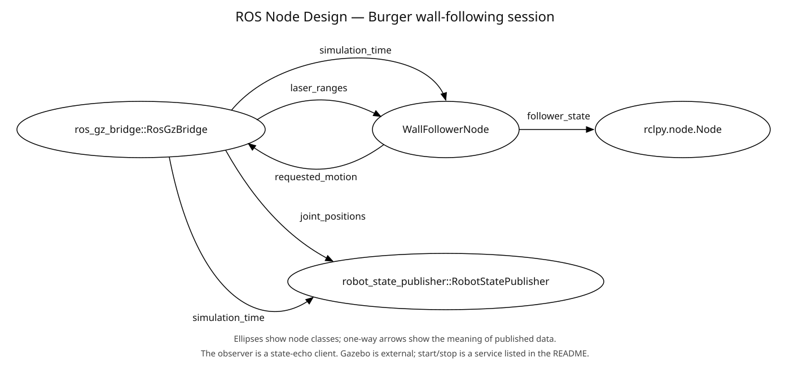
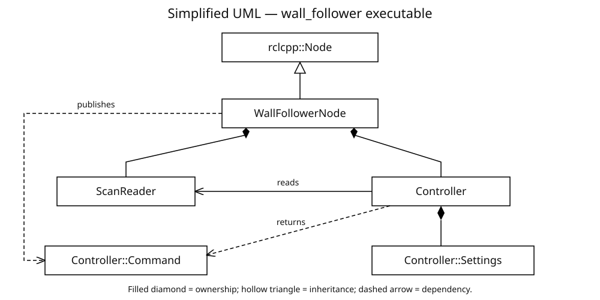

# s02-g24-wallfollower — a right-wall follower

MTRX3760 Project 2, Phase 1 · Section 02, Group 24 · Monday 3–6 PM lab.

This package makes a robot follow a wall on its right using laser measurements. It keeps a target clearance, steers away from obstacles ahead, and searches for the wall when it disappears. You can start and stop it through a ROS service and inspect its current state through a topic. It needs neither a map nor a recorded bag.

The **repository/folder is `s02-g24-wallfollower`**, but the **ROS package is `wall_follower`**, the executable is `wall_follower_node`, and the default node name is `wall_follower`. Use the package name in `ros2` and `colcon` commands.

## Read this first: what has actually been verified

This is a local working implementation adapted from the team's Project 1 source in `../project1_repo`, revision `05df1f5` (the supplied latest GitHub revision). That sibling directory explains its provenance; it is not a build dependency. The package is intended to stand alone.

The development machine is macOS without ROS or Docker. Local C++ core checks are the available executable validation here. **A real Ubuntu 24.04/Jazzy build, ROS integration test run, and Gazebo demonstration remain pending.** Read [the validation record](docs/VALIDATION.md) for recorded results and outstanding checks. Existing Project 1 evidence does not establish that this new package passes integration or simulation.

The development repository is https://github.com/michaeld3n/s02-g24-wallfollower. This implementation is being published there with the user's permission. It is separate from the required university submission repository. No release tag or physical robot validation is implied by this development publication.

## Finding your way around

- [Concepts and control behaviour](#concepts-and-control-behaviour)
- [Install on Ubuntu 24.04](#install-on-ubuntu-2404)
- [Copy the local package to Linux](#copy-the-local-package-to-linux)
- [Build the package](#build-the-package)
- [Run the standard Gazebo world](#run-the-standard-gazebo-world)
- [Interfaces and quality of service](#interfaces-and-quality-of-service)
- [Parameters and launch arguments](#parameters-and-launch-arguments)
- [Tests and evidence](#tests-and-evidence)
- [File map and function inventory](#file-map-and-function-inventory)
- [Troubleshooting](#troubleshooting)
- [Optional physical robot use](#optional-physical-robot-use)
- [Attribution and release checklist](#attribution-and-release-checklist)

## Concepts and control behaviour

A **node** is a running ROS program. A **topic** is a named stream of messages: the laser sends scans and the controller sends velocity commands. A **service** is a request with a reply: here, a boolean means start or stop. A **parameter** is a configuration value. A **launch file** starts programs with chosen parameters and names. A **workspace** holds source packages and their compiled results; `colcon` builds it and `ament_cmake` connects this C++ package to ROS's build system.

This package contains one node and a ROS-independent core. `ScanReader` turns many laser rays into three distances. `Controller` turns those distances into a speed and turn rate. `WallFollowerNode` handles ROS messages, parameters, the service, and the watchdog. Composition means the node owns a reader and a controller; inheritance means the node extends `rclcpp::Node`.

The [node design diagram](docs/node_design.svg) shows external connections. Its editable source is [node_design.puml](docs/node_design.puml). The [simplified class diagram](docs/class_diagram.svg) shows class relationships; its editable source is [class_diagram.puml](docs/class_diagram.puml). The class diagram intentionally omits attributes and methods; the inventory below supplies those details in prose.



This follows Task 5's convention: ellipses contain node class names, and one-way arrows describe the meaning of data rather than topic paths or message types. The bridge and observer are external programs. The observer can be the ROS command-line topic echo node. The start/stop service is listed in the interface table; it is not misrepresented as a publish/subscribe connection. Robot state publishing and simulator internals are outside this controller's interface diagram.



Both diagrams are manually designed. The `.svg` files are viewable companions to the editable `.puml` sources, not generated node-graph captures. A filled diamond means ownership, a hollow triangle points to a base class, and a dashed arrow shows a dependency. Keep both versions consistent when changing the design.

### Reading the C++ without prior ROS experience

| Concept used here | Plain-language meaning |
| --- | --- |
| Class and object | A class is a design for a component; an object is one running instance. `ScanReader`, `Controller`, and `WallFollowerNode` divide observation, decisions and communication. |
| Encapsulation / `private` | Each component keeps its working data inside itself. Other code asks it questions through methods instead of rewriting its internal state. |
| Composition | The ROS node contains a reader and controller. These are helper objects, not extra running ROS nodes. |
| Inheritance | `WallFollowerNode` extends ROS's `rclcpp::Node`, gaining the ability to create publishers, subscriptions and services. No artificial inheritance hierarchy is added to the steering algorithm. |
| Constructor and initializer list | The constructor sets up an object. The list after `:` constructs its parts in the declaration order before the constructor body runs. |
| `struct` | A small record of related values. `Settings` holds tuning values; `Command` holds forward and turning speeds. |
| `const` and references | `const` says a value will not be modified. A reference lets a function read an existing object without copying it. `const` methods promise not to change the object's stored state. |
| `static constexpr` | A named, fixed number belonging to the class, such as the scan-sector width. It makes the meaning of the number visible. |
| `std::vector` | A list whose length can vary, used for laser rays and the valid rays collected for a sector. |
| Namespace and header guard | `wall_follower::` groups our names; header guards prevent a declaration being included twice during compilation. |
| Callback and `std::bind` | A callback is a method ROS calls when a scan, service request or timer event arrives. `std::bind` connects that event to this object's method. |
| Shared pointer | ROS uses reference-counted handles for node interfaces and messages. The resource stays alive while a handle owns it. This does not make the program multithreaded. |
| Executor | ROS's dispatcher. Our single-threaded executor handles callbacks one at a time, so scan/service/timer code does not concurrently edit the controller. |
| State and hysteresis | State is the controller's current mode. A small remembered front-obstacle flag prevents repeated switching around the same distance. |
| Feedback / proportional control | Each new measurement changes steering in proportion to distance and heading error. Gains control how strongly it corrects. This is not a full PID controller. |
| Saturation | Limit the requested turn to a maximum. The robot also slows forward motion during stronger corrections. |
| Time and watchdog | ROS time may come from Gazebo; a separate monotonic clock measures how long scans have stopped arriving. A watchdog simply checks that elapsed time. |
| Unit vs integration test | A core test calls the steering code directly. An integration test launches the real ROS node and sends messages through its actual interfaces. |

Metres measure distance, metres/second measure forward speed, and radians/second measure turning speed. One full circle is approximately 6.283 radians. The robot turns by requesting different effective wheel speeds through its existing base driver; this package does not drive motor hardware directly.

### What the laser reader measures

Angles are measured counterclockwise from forward. Forward is 0°, right is −90°, and front-right is −45°. The code uses each ray's `angle_min + index * angle_increment`, so it does not assume a particular array index means forward. Angles wrap around a full circle; positive and negative nonzero increments are supported.

| Region | Rays considered | How the distance is selected |
| --- | --- | --- |
| Front | 0° ±20° | Smallest valid distance, to react to a close obstacle |
| Right | −90° ±5° | Sorted middle reading, to reduce isolated noise |
| Front-right | −45° ±5° | Sorted middle reading, to estimate wall direction |

For an even number of valid side readings, the upper middle value is selected, not the average of the two middle values. Each scan replaces all three regions; old distances cannot silently fill missing regions.

Finite returns within the inclusive `range_min`–`range_max` interval are usable. Positive infinity means no return within sensor range and is treated as `range_max`. NaN, negative infinity, and finite out-of-range readings are discarded. A region with no usable readings is unknown, not clear. A numerical zero is accepted only if the declared minimum range permits it.

Empty ranges, nonfinite angle metadata, zero angle increment, invalid range bounds, or an overflowing final beam angle invalidate the scan. Range bounds must be finite, `range_min >= 0`, and `range_max > range_min`. `angle_max`, intensity values, scan duration, and the input header timestamp are not used in the control calculation. No transform lookup corrects sensor mounting: the incoming angular convention must already match the robot's forward/right directions.

### How steering works

With a visible right wall, the controller compares its right distance with `wall_distance`. Too close produces a left correction; too far produces a right correction. The diagonal measurement estimates whether the wall slopes toward or away from the robot. With `r` the right distance and `d` the front-right distance, the calculation is:

```text
diagonal_component = d / sqrt(2)
wall_angle = atan2(diagonal_component - r, diagonal_component)
steering = distance_gain * (wall_distance - r) - heading_gain * wall_angle
angular_speed = steering limited to [-turn_speed, +turn_speed]
linear_speed = forward_speed * (1 - 0.5 * abs(angular_speed) / turn_speed)
```

The heading correction is omitted when the diagonal distance is at least `wall_lost_distance`. Forward speed during normal following ranges from half to all of `forward_speed`; the controller does not reverse. Positive angular speed turns left; negative turns right. A blocked front takes priority over wall following and produces an in-place left turn.

**Hysteresis** means different thresholds start and finish a turn: a front distance strictly below `front_stop_distance` starts blocking; once blocked, turning continues until the front is at least `front_resume_distance`. This prevents rapid switching near one threshold. Exactly the stop threshold does not newly trigger blocking; exactly the resume threshold releases it.

If the right distance is strictly greater than `wall_lost_distance`, the robot searches by moving at `forward_speed` and turning right at half `turn_speed`. This is a local reactive search, not a path planner or a guarantee that it will find a wall in an arbitrary world. With all rays at positive infinity it searches, because that represents clear observed space.

### State messages and edge cases

| State string | Meaning and commanded behaviour |
| --- | --- |
| `invalid_configuration` | Invalid numerical settings or timeout; zero velocity, even if disabled |
| `disabled` | Start permission is off; zero velocity continues to be published |
| `waiting_for_scan` | Enabled but no post-transition scan, or receipt watchdog expired; zero velocity |
| `invalid_scan` | A scan arrived but front information is unusable; zero velocity |
| `turning_left` | Front obstacle latched by hysteresis; zero forward speed and positive `turn_speed` |
| `partial_scan` | Front is usable but a side region is missing; cautious recovery described below |
| `searching_wall` | Complete scan but right wall beyond the lost threshold; forward/right curve |
| `following_wall` | Complete usable scan and wall within the lost threshold; distance/heading steering |

The node checks configuration, disabled status, and freshness before it asks the controller to steer. Within the controller, a missing/invalid front stops motion; a blocked front turns left before considering incomplete side information.

With a clear front but incomplete sides, linear motion is capped at **0.01 m/s**. If a valid right wall remains within the lost threshold, distance-only following is used. Otherwise it curves right to search, except that a known front-right obstacle below `front_stop_distance` with no usable right reading causes a stationary left turn at half `turn_speed`. Partial scans are therefore not always a full stop. Invalid front readings reset the front-obstacle latch; so do enable transitions and watchdog expiry.

**Freshness is based on receipt time, not the scan header.** Each scan callback records a monotonic/steady-clock arrival time. More than `scan_timeout` seconds of silence produces `waiting_for_scan` and zero commands. The default is 1.0 second. Old, zero, future, or reset scan header stamps do not by themselves fail a scan. This replaces Project 1's header-time error behaviour and avoids repeated timestamp error messages. The watchdog remains active; zero or negative timeout is invalid, not an off switch. A continually arriving malformed stream produces `invalid_scan`, not a receipt timeout.

The output loop uses a wall timer every 50 ms (nominally 20 Hz), even if simulated time pauses. A stopped simulator may therefore trigger the receipt watchdog. Incoming scans allow automatic recovery while enabled. The output stamped command uses ROS time, so `use_sim_time` must still match the simulator even though the watchdog uses a separate clock.

Normal Ctrl+C requests a final zero command and briefly waits for reliable acknowledgements before shutting down its separate ROS context. This is a best-effort shutdown action, not a guaranteed emergency stop for process crashes, power loss, or network failure. A real base should have its own command timeout.

## Install on Ubuntu 24.04

These are instructions to execute on Linux, not a record of commands successfully run on this Mac. Use Ubuntu 24.04 Noble, ROS 2 Jazzy, and Gazebo Harmonic. Official sources were checked on 16 October 2026. Prefer a Linux desktop with working graphics for the simulator; a VM must provide suitable graphics support.

### 1. Bootstrap the official ROS repository

Follow the official [Jazzy Ubuntu Debian installation guide](https://docs.ros.org/en/jazzy/Installation/Ubuntu-Install-Debs.html) through locale, Ubuntu Universe, and ROS repository setup. The current instructions install `ros2-apt-source`, which supplies the repository configuration and keys. Follow that official bootstrap rather than substituting an old hand-written repository/key command.

The rendered ROS page denied automated access during preparation; its [official Jazzy source](https://github.com/ros2/ros2_documentation/blob/jazzy/source/Installation/Ubuntu-Install-Debs.rst) and [repository setup include](https://github.com/ros2/ros2_documentation/blob/jazzy/source/Installation/_Apt-Repositories.rst) were read directly. The source confirms Ubuntu Noble and the packages below. If `ros-dev-tools` reports dependency conflicts, consult the guide's Ubuntu suites note before changing repositories.

After completing that bootstrap, open a Bash terminal and install:

```bash
sudo apt update
sudo apt install ros-jazzy-desktop ros-dev-tools
sudo apt install build-essential git python3-colcon-common-extensions
source /opt/ros/jazzy/setup.bash
```

`source` loads ROS commands and package paths into the current terminal. It must be repeated in each new terminal. These examples use Bash; in Zsh use the corresponding `setup.zsh` scripts.

### 2. Install the matching Gazebo integration

```bash
sudo apt install ros-jazzy-ros-gz
```

The [official Gazebo ROS installation guide](https://gazebosim.org/docs/harmonic/ros_installation/) identifies Jazzy–Harmonic as the recommended pairing and recommends installing `ros_gz` from the ROS repository. Do not mix these instructions with Gazebo Classic or Humble's default simulator packages.

### 3. Install upstream TurtleBot3 for simulation

Use the **Jazzy tab** in ROBOTIS's [PC setup](https://emanual.robotis.com/docs/en/platform/turtlebot3/quick-start/) and [simulation instructions](https://emanual.robotis.com/docs/en/platform/turtlebot3/simulation/). The pages contain instructions for multiple distributions. Their Jazzy sources use these branches:

```bash
source /opt/ros/jazzy/setup.bash
mkdir -p ~/turtlebot3_ws/src
cd ~/turtlebot3_ws/src
git clone -b jazzy https://github.com/ROBOTIS-GIT/DynamixelSDK.git
git clone -b jazzy https://github.com/ROBOTIS-GIT/turtlebot3_msgs.git
git clone -b jazzy https://github.com/ROBOTIS-GIT/turtlebot3.git
git clone -b jazzy https://github.com/ROBOTIS-GIT/turtlebot3_simulations.git
```

These clones fetch upstream dependencies, not this team's unpublished implementation. If a directory already exists, inspect and reuse its correct Jazzy checkout instead of cloning into it again.

Initialize `rosdep` once per Linux installation, if not already initialized, then resolve the packages' declared dependencies and build:

```bash
sudo rosdep init
rosdep update
cd ~/turtlebot3_ws
rosdep install --from-paths src --ignore-src --rosdistro jazzy -r -y
colcon build --symlink-install
source install/setup.bash
ros2 pkg prefix turtlebot3_gazebo
```

Skip `sudo rosdep init` when already initialized; do not delete an existing configuration to repeat it. `rosdep` installs system dependencies, while `colcon` compiles source. See the [official rosdep guide](https://docs.ros.org/en/jazzy/Tutorials/Intermediate/Rosdep.html). The upstream simulator is separate from this controller and is not bundled here.

## Copy the local package to Linux

Once this development commit is on GitHub, the simplest way to get it on Linux is:

```bash
mkdir -p ~/wall_follower_ws/src
cd ~/wall_follower_ws/src
git clone https://github.com/michaeld3n/s02-g24-wallfollower.git
```

If that destination already exists, inspect its local changes before updating it. The following direct-copy options are useful for transferring further local edits before they are pushed.

The Linux destination should be `~/wall_follower_ws/src/s02-g24-wallfollower`. For direct copying, copy the entire current local folder, including any new untracked source, configuration, tests, diagrams, `LICENSE`, and `NOTICE`.

On Linux, first create the destination:

```bash
mkdir -p ~/wall_follower_ws/src/s02-g24-wallfollower
```

Choose one transfer method. Replace `linuxuser` and `linux-host` with your actual SSH login and machine name/IP. Run the network transfer on the Mac only after arranging access to your Linux machine.

**rsync**, if available on both machines, transfers the directory contents and excludes build results:

```bash
rsync -av --exclude='.git/' --exclude='build/' --exclude='install/' \
  --exclude='log/' --exclude='__pycache__/' --exclude='.DS_Store' \
  /Users/michaeldeng/Desktop/MTRX3760/s02-g24-wallfollower/ \
  linuxuser@linux-host:wall_follower_ws/src/s02-g24-wallfollower/
```

The trailing slash on the local directory means “copy its contents.” This command does not delete destination files; it can update matching files, so use a dedicated destination without independent edits.

**scp** is a simpler alternative for an initially empty destination:

```bash
scp -r /Users/michaeldeng/Desktop/MTRX3760/s02-g24-wallfollower \
  linuxuser@linux-host:wall_follower_ws/src/
```

Unlike the rsync example, this includes `.git` and any local build output; do not reuse Mac build products on Linux. **USB/shared folder** also works: copy the complete folder through the file manager, then place it directly inside Linux's `wall_follower_ws/src`. Ensure you have not accidentally created a duplicate nested folder.

On Linux, check the result before building:

```bash
cd ~/wall_follower_ws/src/s02-g24-wallfollower
ls package.xml CMakeLists.txt src include launch config test scripts docs LICENSE NOTICE
```

## Build the package

Use a fresh Bash terminal. Avoid sourcing the old Project 1 workspace: it contains a modified package also named `turtlebot3_gazebo` and can shadow the standard upstream simulator.

```bash
source /opt/ros/jazzy/setup.bash
source ~/turtlebot3_ws/install/setup.bash
cd ~/wall_follower_ws
rosdep install --from-paths src --ignore-src --rosdistro jazzy -r -y
colcon build --symlink-install --packages-select wall_follower
source install/setup.bash
ros2 pkg prefix wall_follower
ros2 pkg executables wall_follower
```

Run `rosdep update` first if it has not been run on this machine. A successful build should expose `wall_follower wall_follower_node`; this is an expected result to check, not a claim of completed Linux validation.

The workspace now contains `src/` (your inputs), `build/` (intermediate compilation), `install/` (runnable package/headers/configuration), and `log/` (build/test reports). The latter three are generated and ignored by Git. `--symlink-install` makes many installed resources refer back to source; C++ changes still require rebuilding. If configuration edits appear absent, check the installed file and rebuild.

For controller-only ROS tests you do not need TurtleBot3 or Gazebo: source Jazzy and build this package with its declared dependencies. TurtleBot3 is required for the simulator walkthrough below.

## Run the standard Gazebo world

Use separate terminals so each process's output is visible. In **every terminal**, first run:

```bash
source /opt/ros/jazzy/setup.bash
source ~/turtlebot3_ws/install/setup.bash
source ~/wall_follower_ws/install/setup.bash
```

Do not run another command-velocity producer such as teleoperation, navigation, or the upstream autonomous drive example on the same robot topic. Even while disabled, this controller publishes zero velocity.

### Terminal A: the world and virtual robot

```bash
export TURTLEBOT3_MODEL=burger
ros2 launch turtlebot3_gazebo turtlebot3_world.launch.py
```

This is the standard upstream TurtleBot3 world, not a Project 1 custom maze. The [Jazzy launch source](https://github.com/ROBOTIS-GIT/turtlebot3_simulations/blob/jazzy/turtlebot3_gazebo/launch/turtlebot3_world.launch.py) starts Gazebo server/client, spawns the robot, and starts its state publisher. Allow the world to finish loading and check that simulation is playing.

### Terminal B: inspect the simulator, then start the controller

```bash
ros2 topic list -t
ros2 topic info /scan --verbose
ros2 topic info /cmd_vel --verbose
ros2 topic echo /scan --once --qos-reliability best_effort
ros2 topic echo /clock --once
ros2 launch wall_follower wall_follower.launch.py use_sim_time:=true
```

Inspect `/cmd_vel` before the controller starts to identify the robot subscriber's type. The controller defaults to `geometry_msgs/msg/TwistStamped`. If the robot actually subscribes to `geometry_msgs/msg/Twist`, use this alternative launch instead:

```bash
ros2 launch wall_follower wall_follower.launch.py \
  use_sim_time:=true use_stamped_cmd_vel:=false
```

Only run one of these controller launches. `wall_follower.launch.py` starts **only the controller**; it neither starts a simulator nor launches hardware drivers. It starts disabled, so the robot should remain still until explicitly enabled.

### Terminal C: monitor, enable, and stop

Read the initial state:

```bash
ros2 topic echo /state --once --qos-durability transient_local --qos-reliability reliable
```

Enable, then inspect the output:

```bash
ros2 service call /set_enabled std_srvs/srv/SetBool '{data: true}'
ros2 topic echo /cmd_vel --once
ros2 topic echo /state
```

Ctrl+C stops the last `echo` command only; it does not disable the controller. To stop motion, call:

```bash
ros2 service call /set_enabled std_srvs/srv/SetBool '{data: false}'
```

An enable transition deliberately discards pre-transition scans. It stays at zero in `waiting_for_scan` until a new scan arrives, then chooses the appropriate control state. A successful service response means the request was accepted, not that a wall has been found or the robot is already moving.

Expected observations to verify: a wall within reach gives `following_wall`; a nearby obstacle ahead gives `turning_left`; open space gives `searching_wall`; stopping scan delivery gives `waiting_for_scan` after the timeout. Stop through the service before ending the controller and simulator with Ctrl+C. Record actual observations in the validation document.

## Interfaces and quality of service

**QoS** (“quality of service”) describes delivery and queue rules. Best effort favours timely sensor data and can drop packets; reliable requests delivery acknowledgements. Volatile retains no history for newcomers; transient local lets a late subscriber obtain the publisher's retained sample while that publisher exists.

All four application names are **relative**, so a namespace or remapping can relocate them. With no namespace, they resolve as follows:

| Direction | Relative/default resolved name | ROS interface | QoS / timing |
| --- | --- | --- | --- |
| Subscribe | `scan` → `/scan` | `sensor_msgs/msg/LaserScan` | `rclcpp::SensorDataQoS`: keep-last 5, best effort, volatile |
| Publish | `cmd_vel` → `/cmd_vel` | `geometry_msgs/msg/TwistStamped` by default; `Twist` if configured | Keep-last 10, reliable, volatile; nominal 20 Hz |
| Publish | `state` → `/state` | `std_msgs/msg/String` | Keep-last 1, reliable, transient local; nominal 20 Hz, including unchanged states |
| Service server | `set_enabled` → `/set_enabled` | `std_srvs/srv/SetBool` | Standard ROS service QoS: reliable, volatile, keep-last 10 |

Only `linear.x` (m/s) and `angular.z` (rad/s) are commanded; other velocity components are zero. In stamped mode the `Twist` is inside `.twist`, `header.stamp` is the node's current ROS time, and `header.frame_id` is `base_link`. In plain mode there is no header. The node creates only one command publisher type per run; there is no automatic format conversion.

`SetBool` request field `data` is true to enable and false to disable; response fields are `success` and explanatory `message`. Actual value changes reset the controller and require a subsequent scan. Repeating the existing value is accepted without resetting freshness. A successful enable replies `Enabled`; a successful disable replies `Disabled; zero velocity sent`. Disable invokes an immediate zero-output update. Enabling invalid settings is rejected; disabling is accepted, but the diagnostic state remains `invalid_configuration` because that has priority.

ROS also supplies normal parameter services, parameter events, and logging (`/rosout`); `use_sim_time=true` enables ROS clock input from `/clock`. These are framework interfaces, not extra application control topics. This package publishes no odometry, transforms, map, path, or navigation action and subscribes to no pose or camera feed.

### Namespaces and remapping

For a robot already exposing namespaced scan and command topics:

```bash
ros2 launch wall_follower wall_follower.launch.py \
  namespace:=robot1 use_sim_time:=true
ros2 service call /robot1/set_enabled std_srvs/srv/SetBool '{data: true}'
```

The launch and service commands belong in separate terminals. The endpoints become `/robot1/scan`, `/robot1/cmd_vel`, `/robot1/state`, and `/robot1/set_enabled`; the node becomes `/robot1/wall_follower`. This does not automatically namespace the simulator or robot drivers.

To keep the node namespaced but connect it to an unnamespaced simulator:

```bash
ros2 launch wall_follower wall_follower.launch.py \
  namespace:=robot1 use_sim_time:=true scan_topic:=/scan cmd_vel_topic:=/cmd_vel
```

Absolute remap targets beginning with `/` ignore the namespace. Relative targets inherit it. `state_topic` and `enable_service` work the same way. Multiple robots must have separate command destinations; two nodes publishing competing commands to one robot are not coordinated by this package.

## Parameters and launch arguments

These are startup settings. All package-declared parameters are **read-only after startup**, including `start_enabled`, the message-type switch, and the watchdog. Use the service for runtime start/stop. The ROS-provided `use_sim_time` parameter is not marked read-only by this package; choose its correct value at launch.

| Parameter | Default | Unit/type | Meaning and validity |
| --- | --- | --- | --- |
| `wall_distance` | `0.25` | m, double | Target right clearance; greater than zero |
| `forward_speed` | `0.10` | m/s, double | Nominal forward speed; greater than zero |
| `turn_speed` | `0.65` | rad/s, double | Maximum steering magnitude and blocked-front turn speed; greater than zero |
| `front_stop_distance` | `0.25` | m, double | Enter front-blocked state below this; greater than zero |
| `front_resume_distance` | `0.35` | m, double | Leave blocked state at/above this; greater than stop distance |
| `wall_lost_distance` | `0.90` | m, double | Search when right distance exceeds this; greater than wall distance |
| `distance_gain` | `2.0` | steering gain, double | Distance-error correction; greater than zero |
| `heading_gain` | `1.2` | steering gain, double | Wall-heading correction; zero or greater |
| `scan_timeout` | `1.0` | seconds, double | Maximum scan receipt silence; finite and greater than zero |
| `start_enabled` | `false` | bool | Initial permission to drive; still requires a scan |
| `use_stamped_cmd_vel` | `true` | bool | Select `TwistStamped`; false selects `Twist` |
| `use_sim_time` | `false` | bool | Use `/clock` for ROS time; set true for Gazebo |

All eight steering numbers must be finite as well as satisfying their listed relationships. Numerically invalid configuration yields zero commands and `invalid_configuration`; it cannot be corrected in place because the settings are read-only. A parameter supplied with the wrong ROS type may instead fail declaration/startup. Use decimal YAML values for doubles and actual booleans for booleans. There is no configurable control frequency, sector width, side selection, frame ID, or recovery-speed parameter.

The shipped [YAML](config/wall_follower.yaml) contains the nine numerical defaults. Its `/**` wildcard lets them apply when the node is namespaced. The three booleans are explicitly supplied by launch arguments **after** the YAML and therefore override values in a custom parameter file.

| Launch argument | Default | Purpose |
| --- | --- | --- |
| `params_file` | Installed `config/wall_follower.yaml` | Load a YAML parameter file |
| `use_sim_time` | `false` | Override the corresponding bool parameter |
| `start_enabled` | `false` | Override the corresponding bool parameter |
| `use_stamped_cmd_vel` | `true` | Override the corresponding bool parameter |
| `namespace` | Empty string | Node and relative endpoint namespace |
| `scan_topic` | `scan` | Scan subscription remap target |
| `cmd_vel_topic` | `cmd_vel` | Velocity publication remap target |
| `state_topic` | `state` | State publication remap target |
| `enable_service` | `set_enabled` | Start/stop service remap target |

Example with a separately edited configuration file:

```bash
ros2 launch wall_follower wall_follower.launch.py \
  params_file:=/absolute/path/to/my_wall_follower.yaml \
  use_sim_time:=true start_enabled:=false
```

To tune, disable, terminate, edit YAML, and relaunch. Numerical parameter names such as `wall_distance` are not launch arguments in this launch file. For direct executable use, the ROS parameter syntax is available:

```bash
ros2 run wall_follower wall_follower_node --ros-args \
  --params-file ~/wall_follower_ws/src/s02-g24-wallfollower/config/wall_follower.yaml \
  -p use_sim_time:=true -p start_enabled:=false -p use_stamped_cmd_vel:=true
```

Do not run this alongside the launch-based instance. Inspect configuration without changing it:

```bash
ros2 param list /wall_follower
ros2 param get /wall_follower scan_timeout
ros2 param describe /wall_follower wall_distance
```

## Tests and evidence

### Local core checks without ROS

From the repository root, with a C++17 compiler available:

```bash
bash scripts/test_core.sh
```

This compiles the scan reader, controller, and core tests without ROS. It is useful on macOS or Linux, but cannot prove ROS APIs compile, QoS connects, services work, or the virtual robot moves. Consult the script and [validation record](docs/VALIDATION.md) for the compiler/run details and observed results.

### Linux ROS integration checks

After building on Ubuntu with Jazzy sourced:

```bash
cd ~/wall_follower_ws
source /opt/ros/jazzy/setup.bash
source install/setup.bash
colcon test --packages-select wall_follower --event-handlers console_direct+
colcon test-result --verbose
```

`CMakeLists.txt` registers the C++ test and the Python launch test when `BUILD_TESTING` is enabled (the usual development configuration). The integration test uses `ament_cmake_ros`'s `run_test_isolated.py` runner to assign an isolated ROS domain. It launches actual controller processes in `stamped` and `plain` namespaces, sends handmade laser scans, and checks states and velocity output for both message types. It requires ROS, but neither Gazebo nor a robot nor a bag.

Coverage includes disabled output despite incoming scans, enable waiting for a new scan, straight following, left/right correction, blocked-front turning, wall search, malformed front/all-invalid scans, recovery, old/future header stamps, receipt timeout, stop/re-enable, and process exit codes. Test waits use monotonic deadlines and require stable observations across multiple timer ticks; they do not merely check that a topic exists. Synthetic tests do not validate physical stopping distance or Gazebo model wiring.

For simulation evidence, separately verify the complete walkthrough: correct topic types, fresh scans, expected states, motion near a wall, turning at an obstacle, stop/re-enable, and watchdog recovery. Record Ubuntu/ROS/Gazebo versions, commands, output, and observations. A rosbag is optional evidence, not a dependency or required input for this wall-following package. Do not copy bag requirements from unrelated project phases into this workflow.

## File map and function inventory

Headers (`.hpp`) declare the C++ types and callable methods; sources (`.cpp`) implement them. The inventory lists each repository file, excluding Git's internal `.git/` database and ignored generated output. Documentation, configuration, and build files have no runtime C++ functions.

```text
s02-g24-wallfollower/
├── .gitignore
├── AGENTS.md
├── CMakeLists.txt
├── LICENSE
├── NOTICE
├── README.md
├── package.xml
├── config/
│   └── wall_follower.yaml
├── docs/
│   ├── VALIDATION.md
│   ├── class_diagram.puml
│   ├── class_diagram.svg
│   ├── node_design.puml
│   └── node_design.svg
├── include/wall_follower/
│   ├── controller.hpp
│   ├── scan_reader.hpp
│   └── wall_follower_node.hpp
├── launch/
│   └── wall_follower.launch.py
├── scripts/
│   └── test_core.sh
├── src/
│   ├── controller.cpp
│   ├── main.cpp
│   ├── scan_reader.cpp
│   └── wall_follower_node.cpp
└── test/
    ├── test_core.cpp
    └── test_integration.py
```

| File | Individual purpose |
| --- | --- |
| `README.md` | This usage, design, interface, and maintenance guide |
| `AGENTS.md` | Repository work rules, acceptance checklist, and publication restriction |
| `.gitignore` | Excludes compilation, ROS workspace output, editor/cache files, and platform debris |
| `package.xml` | Package name/version, maintainer, Apache licence declaration, build/runtime/test dependencies |
| `CMakeLists.txt` | C++17 build, core library and node targets, installation/export, core and isolated launch tests |
| `LICENSE` | Apache License 2.0 terms |
| `NOTICE` | Provenance, attribution, and adaptation/AI-use notices |
| `include/wall_follower/scan_reader.hpp` | `ScanReader` API and private `Sector` distance/validity record |
| `src/scan_reader.cpp` | Angle-aware filtering and front/minimum, side/median extraction |
| `include/wall_follower/controller.hpp` | `Controller`, startup `Settings`, and linear/angular `Command` API |
| `src/controller.cpp` | Settings validation, state decisions, front hysteresis, following and search calculations |
| `include/wall_follower/wall_follower_node.hpp` | ROS adapter declaration, owned interfaces, watchdog/timer state |
| `src/wall_follower_node.cpp` | Parameters, topics, service callbacks, scheduling, and shutdown output |
| `src/main.cpp` | Executable entry point and ROS context lifecycle |
| `config/wall_follower.yaml` | Namespace-compatible numerical startup defaults |
| `launch/wall_follower.launch.py` | Starts this controller alone, with parameters, namespace, and remaps |
| `scripts/test_core.sh` | Standalone compiler/test runner for the ROS-independent core |
| `test/test_core.cpp` | C++ assertions/checks against scan processing and steering logic |
| `test/test_integration.py` | Isolated ROS launch test for stamped and plain output plus shutdown checks |
| `docs/node_design.puml` | Editable manual ROS Node Design Diagram source |
| `docs/node_design.svg` | Viewable node diagram; not a substitute screenshot from `rqt_graph` |
| `docs/class_diagram.puml` | Editable simplified UML class relationship diagram source |
| `docs/class_diagram.svg` | Viewable simplified UML diagram, without member listings |
| `docs/VALIDATION.md` | Actual validation evidence, limitations, and pending Linux/simulator checks |

### ScanReader functions (`scan_reader.hpp` / `scan_reader.cpp`)

| Function | Purpose |
| --- | --- |
| `Update(...)` | Replace previous readings, validate metadata, and calculate all three sectors |
| `ReadSector(...)` | Private static helper: collect valid rays within angular bounds and return minimum or middle value |
| `HasValidReadings()` | True only when all three sectors have usable data |
| `HasValidFrontReading()` | Whether front distance can be used |
| `HasValidRightReading()` | Whether right distance can be used |
| `HasValidFrontRightReading()` | Whether diagonal distance can be used |
| `HasReceivedScan()` | Whether any `Update` has happened, even if that scan was malformed |
| `FrontDistance()` | Return stored front distance; caller must check validity |
| `RightDistance()` | Return stored right distance; caller must check validity |
| `FrontRightDistance()` | Return stored diagonal distance; caller must check validity |

### Controller functions (`controller.hpp` / `controller.cpp`)

| Function | Purpose |
| --- | --- |
| `Settings::IsValid()` | Check all eight steering values for finiteness and allowed relationships |
| `Controller(settings)` | Store fixed startup settings and reset the initial state |
| `CalculateCommand(scan)` | Choose the control state and produce a linear/angular command |
| `StateName()` | Return the latest diagnostic string |
| `Reset()` | Clear front hysteresis and restore waiting/invalid-configuration state |
| `HasValidSettings()` | Expose settings validity to the ROS adapter |
| `UpdateFrontBlocked(distance)` | Private helper implementing stop/resume hysteresis |
| `FollowWall(right, front_right)` | Private distance/heading steering with limited angular speed and forward slowdown |
| `CurveRightToFindWall()` | Private helper returning nominal forward speed and half-rate right turn |

`Settings` is the eight-value configuration record; `Command` is the two-value output record with zero defaults. Neither needs ROS messages. The reader reports observations; the controller decides movement; the adapter decides whether movement is currently permitted.

### ROS adapter functions (`wall_follower_node.hpp` / `wall_follower_node.cpp`)

| Function | Purpose |
| --- | --- |
| `WallFollowerNode(options)` | Construct the node, declare settings, and create publishers, subscription, service, and timer |
| `ReadDouble(name, value)` | Declare a read-only double and return the supplied/default value |
| `ReadBool(name, value)` | Declare a read-only boolean and return the supplied/default value |
| `ReadSettings()` | Gather the controller's eight startup parameters |
| `OnScan(message)` | Feed laser metadata/ranges to the reader and record steady receipt time |
| `SetEnabled(request, response)` | Validate enabling, reset on transition, reply, and immediately update output |
| `Update()` | Apply configuration/permission/freshness checks, then calculate and publish a command/state |
| `Publish(command, state)` | Format selected velocity type and publish both velocity and state |
| `Run()` | Spin a single-threaded executor with a 100 Hz polling loop; cancel timer and send final zero on exit |

The 100 Hz executor polling rate is not the control publication rate; the 50 ms timer supplies nominal 20 Hz output. Service callbacks can trigger an additional publication. Scheduling is not hard real time.

### Entry point, launch, and integration functions

| File / function | Purpose |
| --- | --- |
| `src/main.cpp`: `main(argc, argv)` | Initialize the signal-handled default context and separate node context, construct/run the node, then shut both down |
| `launch/wall_follower.launch.py`: `generate_launch_description()` | Declare nine launch arguments and return a description containing the one controller node |
| `test/test_integration.py`: `generate_test_description()` | Launch stamped/plain nodes with 0.5 s test watchdogs and signal test readiness |
| `TestWallFollower.setUp()` | Create an isolated Python context/executor and per-node scan publishers, output subscribers, and service clients; await discovery |
| Nested `command_callback(...)` | Normalize either message format to a Twist and store observed commands |
| Nested `state_callback(...)` | Store state strings and observation history |
| `wait_until(...)` | Spin until a condition succeeds or report a bounded timeout |
| `scan(...)` | Construct a 360-ray synthetic laser message with controlled wall/front values and optional header stamp |
| `stopped(command)` | Check all six velocity components are approximately zero |
| `enabled(endpoint, value)` | Call SetBool asynchronously, check acceptance, and clean up an unfinished request |
| `expect(...)` and nested `matches()` | Optionally stream scans at 10 Hz and require a stable matching state/command |
| `assert_stays_stopped(...)` | Check every observed command stays zero and the state remains expected over a duration |
| `test_controller_contract()` and nested `straight(...)` | Run behaviour scenarios for both command formats, including approximately straight default following |
| `TestControllerShutdown.test_exit_codes(...)` | Verify launched processes' exit codes after shutdown |

### Core test and shell helper functions

The test executable contains a `CoreTests` class so its helpers and check counter are encapsulated. Only the required executable entry point is a free function.

| Function | Purpose |
| --- | --- |
| `CoreTests::Run()` | Run the six groups, report the check count, return a failing process status if a check fails |
| `Check(condition, description)` | Count one check and fail with a useful explanation if false; these deliberate test failures must remain |
| `Near(actual, expected, tolerance)` | Compare floating-point results within a small tolerance |
| `State(controller, expected)` | Check the reported control mode |
| `Stopped(command)` | Check both commanded speeds are zero |
| `Scan(front, right, diagonal)` | Make a tiny scan fixture for controller tests |
| `TestScanValidation()` | Exercise empty/invalid metadata and ranges, infinity and range endpoints |
| `TestAnglesAndFiltering()` | Exercise resolutions, wrapped/reversed angles, front minimum and side median |
| `TestSettings()` | Check defaults and reject invalid tuning values |
| `TestControl()` | Check steering, obstacle priority, hysteresis, wall search and reset |
| `TestPartials()` | Check behaviour when only some sectors are available |
| `TestGeometricFeedbackLoop()` | Repeatedly apply steering to a simple geometric model and check convergence to a straight wall; this is not Gazebo |
| Test `main()` | Construct `CoreTests` and return its result |
| Shell `cleanup()` | Remove only the temporary directory created by that core test invocation |

`scripts/test_core.sh` selects `$CXX` if supplied, otherwise Clang or GCC, compiles as C++17 with warnings treated as errors, runs the resulting executable, and cleans up temporary output. The CMake build also uses C++17. Python is used for launch/test plumbing; the running wall-following algorithm and ROS adapter are C++.

## Troubleshooting

| Symptom | What to check or do |
| --- | --- |
| `ros2` or `colcon` not found | Use the Linux installation, install development tools, and source `/opt/ros/jazzy/setup.bash` in this terminal |
| Package/executable not found | Build from the workspace root, source `~/wall_follower_ws/install/setup.bash`, and use package name `wall_follower` |
| Build says docs/licence/test source missing | Check that the complete implementation was cloned or copied, including all files in the map below |
| ROS dependencies missing | Run `rosdep update` and the package's `rosdep install` command; inspect the first build error |
| Unexpected custom world or old executable | Use a fresh terminal without Project 1 overlays; inspect `ros2 pkg prefix turtlebot3_gazebo` and `ros2 pkg prefix wall_follower` |
| Gazebo window absent/black or crashes | Inspect Terminal A logs, graphics drivers and desktop/VM support; check correct Harmonic/Jazzy packages and that only one world is running |
| Gazebo exists but robot/sensors do not | Wait for model loading; check spawn/bridge errors, `TURTLEBOT3_MODEL`, `/scan`, and `/clock`; this controller launch cannot spawn a robot |
| State remains `disabled` | Call the actual resolved `set_enabled` service; setting `start_enabled` at runtime is not supported |
| State remains `waiting_for_scan` | Ensure scans arrive after enabling, topic remapping and QoS are correct, and Gazebo is playing; use `ros2 topic hz /scan` and a best-effort echo |
| `invalid_scan` | Inspect range/angle metadata and front coverage; all NaNs or unknown front is not usable free space |
| `partial_scan` / unusually slow motion | Check side/diagonal field of view, sensor mounting and invalid returns; recovery is deliberately capped at 0.01 m/s |
| `searching_wall` in open space | A right wall must be within `wall_lost_distance`; use the standard world with obstacles and a suitable starting position, not an empty world |
| Commands published but no motion | Inspect the robot subscriber's actual topic/type and QoS with `ros2 topic info --verbose`; restart with the appropriate stamped/plain switch and stop competing publishers |
| CLI reports more than one topic type | Stop conflicting publishers; inspect endpoints, then run only the matching command format |
| Service waits indefinitely | Check `ros2 service list -t`, namespace/remap, whether the node is running, and ROS discovery/domain settings |
| `invalid_configuration` / enable refused | Check finiteness, positive values and ordering constraints, edit startup configuration, and restart |
| `ros2 param set` rejects a value as read-only | Expected for package parameters; change the YAML and restart, or use SetBool to change running permission |
| Simulator time reset or old scan header | Old stamps are accepted; check arrival continuity and `/clock` instead of disabling the watchdog |
| Stamped commands have zero/wrong time | Check `use_sim_time` and `/clock`; the receipt watchdog can work even while ROS time is wrong |
| Works in one terminal but not another | Repeat source commands in the same order and check that ROS domain/discovery settings match |
| Integration test fails | Read `colcon test-result --verbose` and workspace logs; a local core pass is not a substitute for investigating ROS failures |

Useful read-only checks:

```bash
ros2 node list
ros2 node info /wall_follower
ros2 topic info /scan --verbose
ros2 topic info /cmd_vel --verbose
ros2 service list -t
ros2 param get /wall_follower use_sim_time
```

Adjust names for your namespace. A reliable scan subscription cannot necessarily match a best-effort sensor publisher; this node intentionally requests sensor QoS. The state publisher retains one value for a compatible late subscriber, but repeated state messages are normal.

## Optional physical robot use

Physical operation is **unverified for this package**. The simulator setup above requires no hardware, and no hardware connection has been made. A person responsible for the robot must perform bringup and supervise any later trial with an accessible stop method. Follow the robot's matching official bringup instructions, not assumptions from a different model or ROS release.

Before enabling, inspect the actual sensor topic and its `sensor_msgs/msg/LaserScan` type, angular convention, coverage, range limits, and QoS. Inspect the base's command subscriber and select stamped/plain output accordingly. Set `use_sim_time:=false`, use appropriate namespaces/remaps and shared ROS discovery settings, and verify the base's own command timeout. Account for sensor position, robot footprint, turning clearance, and real stopping distance when choosing parameters. This simple sector controller does not implement a complete collision envelope or safety system.

Keep `start_enabled:=false` until the responsible operator is ready. Reuse the documented SetBool stop/start interface. Do not run autonomous and teleoperation publishers concurrently on the same command topic. A software stop request is not a physical emergency stop.

## Attribution and release checklist

The original right-wall-following and scan-reader concepts come from the team's Project 1 `CWallFollower` and `CScanReader`. Existing author labels include Cody, royce, Marz, and Paekinator; preserve those labels rather than inventing legal names or individual contributions. Project 1 revision `05df1f5` is the adaptation baseline. This package separates the reusable controller from Project 1's custom simulator, obstacle plugins, recording utilities, and maze assets.

OpenAI Codex assisted with adaptation, implementation, tests, and documentation. File headers and [NOTICE](NOTICE) record provenance and AI assistance; they do not establish human review or completed runtime validation. Review the code and comply with the unit's AI disclosure requirements. The package declares Apache-2.0; see [LICENSE](LICENSE), and retain relevant upstream attribution when redistributing derived work. Upstream TurtleBot3 is installed separately and retains its own notices.

Before a later release:

- Finish and record the clean Ubuntu/Jazzy build, core and isolated ROS tests, and standard Gazebo demonstration.
- Check the documented interfaces/defaults against the final code and both editable/rendered diagrams.
- Verify a complete clean source copy contains all install inputs and builds without the sibling Project 1 repository.
- Review author headers, licence/NOTICE, AI disclosure, and the unit's required node/class diagram conventions.
- Keep generated binaries, workspace build/install/log output, and unrelated data out of the source submission.
- Confirm the final private university destination `mtrx3760-26/s02-g24-wallfollower` on `github.sydney.edu.au`; the development GitHub.com remote is a separate destination.
- Obtain explicit user authorization before publishing any code, branch, or tag. The brief's eventual `v1.0` publication requirement does not authorize a push now. Do not move an already published tag.

This guide contains no remote publication commands. Future pushes and release tags still require explicit user authorization.
